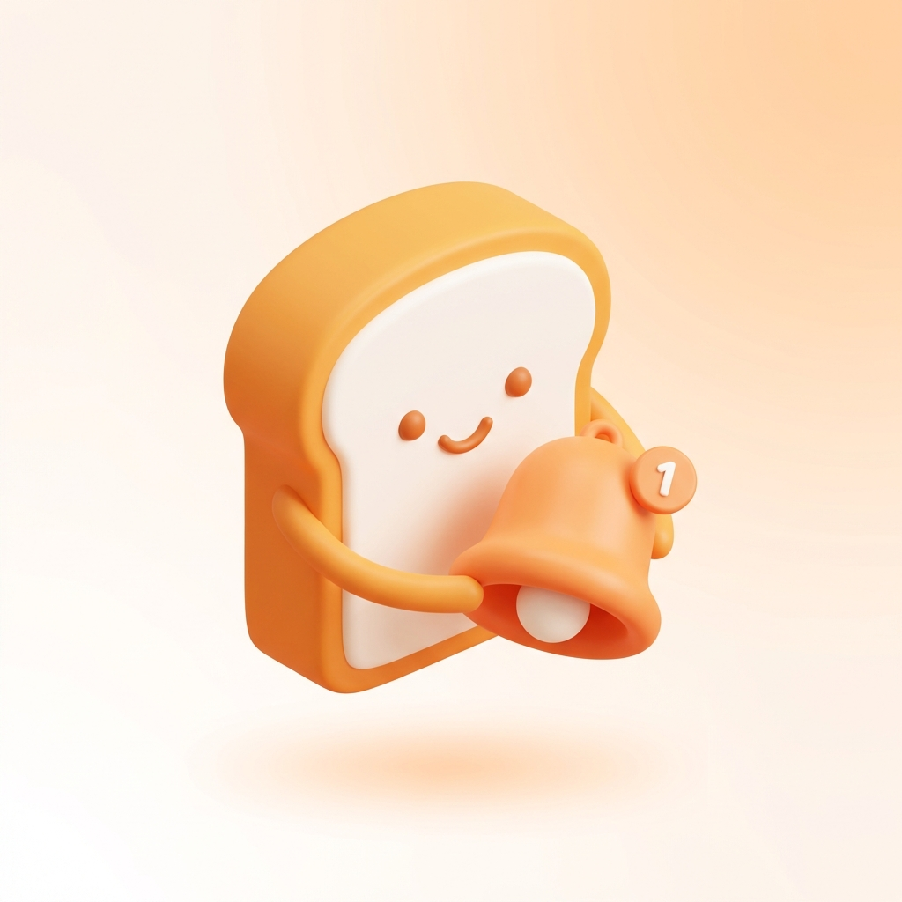
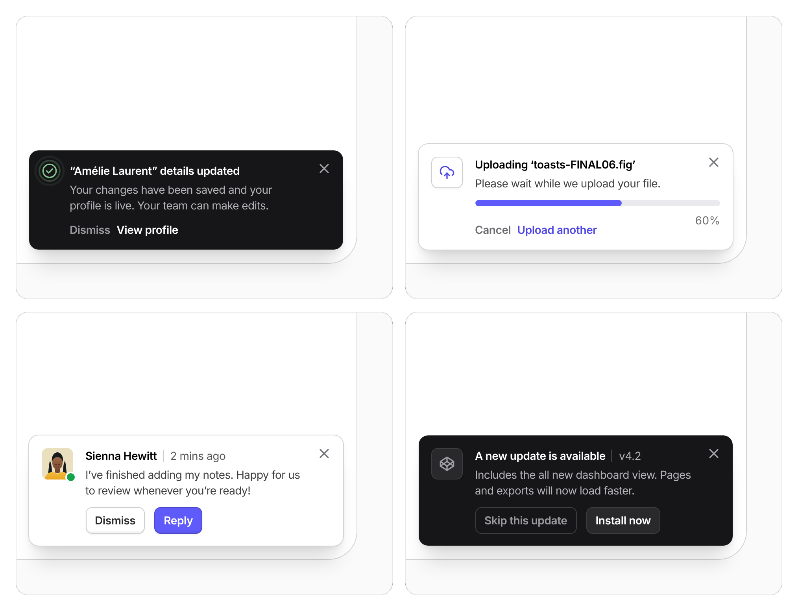

<p align="center">
  
</p>

<h1 align="center">Notifier</h1>

Toast notifications for React, built from slots: an icon or avatar, a title, a description, progress and actions.

<p align="center">
  
  
  
  
  
  
  
</p>

<p align="center">
  
</p>

A toast is a surface with slots. Pass the slots as one object to `notify`, or compose the same parts yourself for layouts the slots do not cover.

- **Slots**: icon or avatar, title with meta, description, progress and actions, in a light or dark tone.
- **Updates in place**: `notify.update` and `notify.promise` change an open toast, so a progress toast stays one element.
- **Number animation**: `animateNumbers` rolls the digits of numbers in a toast when an update changes them, with no extra package.
- **Primitives**: `Toast` and its parts render any layout through `notify.custom`.
- **Tokens**: colors, radius, width, spacing and font are CSS variables, set from the `theme` prop or your own stylesheet. The stylesheet can sit in a cascade layer so Tailwind v4 utilities override it.
- **Behavior**: six positions, hover and focus pause, swipe to dismiss, an expanding stack and reduced motion.
- **Keyboard**: `Alt+T` focuses the newest toast, Tab reaches its actions and Escape dismisses it.

The API reference is in [llm.txt](llm.txt).

## Install

```bash
bun add @remcostoeten/notifier motion
# or
npm install @remcostoeten/notifier motion
```

Mount `Notifier` once, then call `notify` from client code. The stylesheet ships with the component.

```tsx
import { Notifier, notify } from '@remcostoeten/notifier'

export default function RootLayout({ children }: { children: React.ReactNode }) {
    return (
        <html>
            <body>
                {children}
                <Notifier />
            </body>
        </html>
    )
}

notify('Saved')

notify({
    tone: 'dark',
    status: 'success',
    title: 'Details updated',
    description: 'Your changes have been saved.',
    actions: [{ label: 'Dismiss', color: 'muted' }, { label: 'View profile' }]
})
```

Toasts use Inter when the page loads it and the system font otherwise.

## Development

Needs Bun 1.2 or newer.

```bash
bun install        # install the workspace
bun run test       # vitest
bun run build      # tsup to dist/
bun run dev        # tsup in watch mode
```

Contribution notes are in [CONTRIBUTING.md](CONTRIBUTING.md).

<br/>

xxx,<br/>
[Remco Stoeten](https://remcostoeten.com)<br/>
<small>MIT</small>
